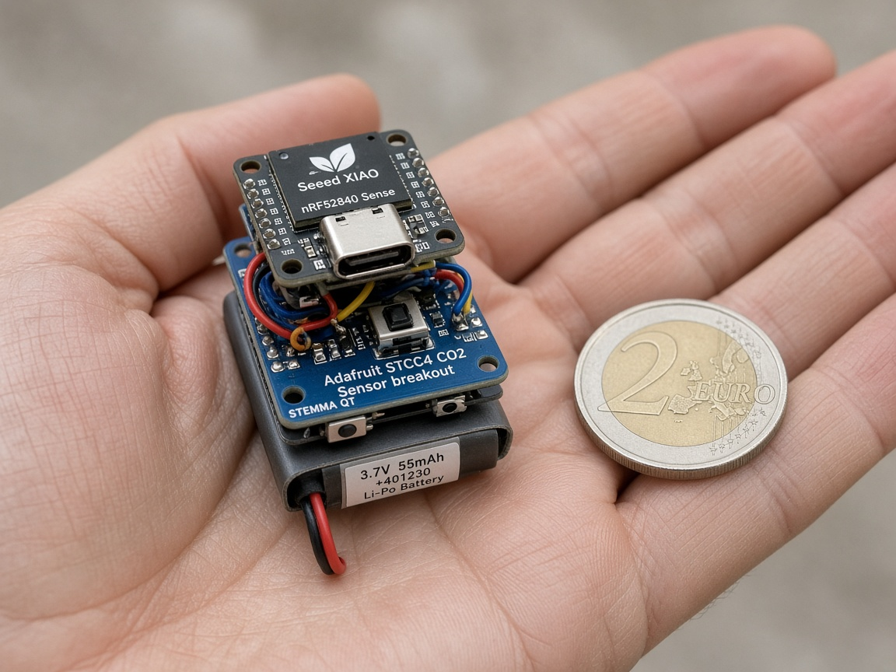
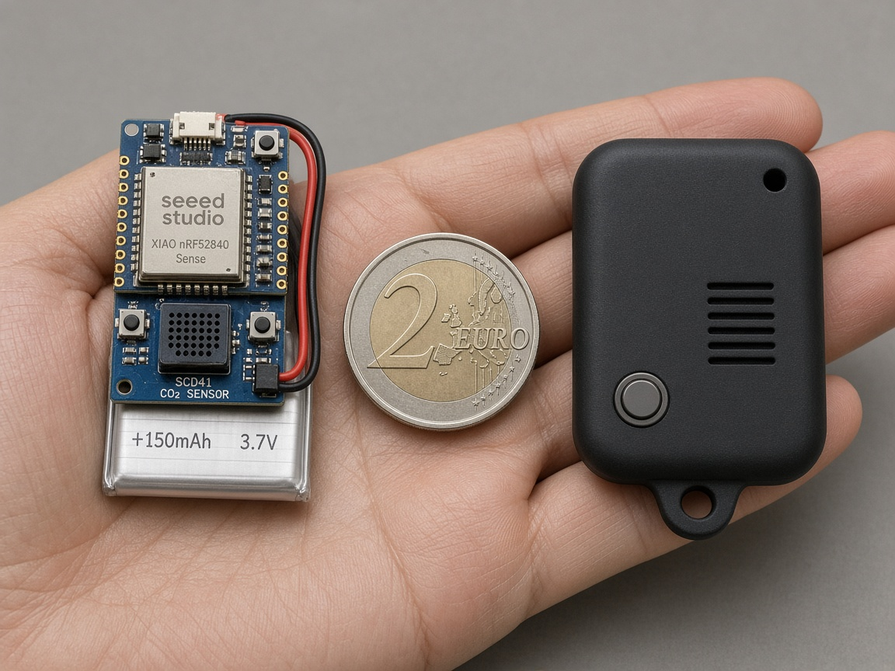

# agent-pendant: easy MVP

A wearable AI pendant: **hold a button, talk, release, and have the recording delivered automatically to Max's existing Grok Bot through an iPhone.** It also reads **CO2** every 5 minutes and sends alerts to the phone. No vibration, no screen, no speaker.

This repo is the **easy MVP (v1)**: the cheapest build that tests the idea on your body for real, made from off-the-shelf parts and the firmware that's already written. The small custom pendant is **v2** and is planned in [`NEXT_V2.md`](NEXT_V2.md).

> **Decision (2026-10-30): build the easy MVP.** Seeed XIAO nRF52840 Sense + STCC4/SHT40 CO2 module + small LiPo + a button. **≈ €49–56 delivered to Finland.** Nothing ordered yet; Max orders everything himself. Nothing has been tested on hardware yet.

## Start here
1. [`STEP0_PHONE_TEST.md`](STEP0_PHONE_TEST.md): free, today. Try hold-to-talk with your phone and earbuds before buying anything.
2. [`ORDER_LIST.md`](ORDER_LIST.md): **what to buy**, re-checked live on 2026-10-30 ([`ORDER_LIST.csv`](ORDER_LIST.csv)).
3. [`BUILD_GUIDE.md`](BUILD_GUIDE.md): wiring, assembly, flashing, testing, LiPo safety, troubleshooting.
4. [`NEXT_V2.md`](NEXT_V2.md): how this turns into the small custom board, and what v1 must teach us first.
5. [`VOICE_TO_GROK_BOT.md`](VOICE_TO_GROK_BOT.md): **the goal**: automatic iPhone delivery of each held-to-talk recording to Grok Bot; audio-email routine first, transcript-webhook fallback.
6. [`SESSION_LOG.md`](SESSION_LOG.md): the decisions so far.

## How we got here
We started from the specs in [`original/`](original/) with a big round **Ø52 mm** case, which Max found far too big to wear as an amulet, so it became a **slim Ø35 × 16 mm** round case with no vibration motor, hold-to-talk only and every notification going through the phone. That still looked like "quite a statement" around the neck, so we looked at the smallest hardware on the market: first a **hand-built stack** of dev boards (≈ 25 × 21 × 12 mm bare, rejected for size), then a **custom board** ("Option 2": u-blox BMD-340 module on a Ø26 mm PCB, ≈ Ø28.5 × 8.5 mm finished, minimum path ≈ €170–330). Max then decided to make the first version **as cheap as possible**: the cheapest real-CO2 build is the off-the-shelf XIAO stack at **≈ €49–56** with the firmware already written, so that is v1, and the custom board moves to v2, sized with what v1 teaches us.

## Size
| Version | Size (est.) | Notes |
|---|---|---|
| **Easy MVP, bare stack** | ≈ 30 × 21 × 12–14 mm with the 100 mAh cell in the order list (≈ 25 × 21 × 12–14 mm with a 150 mAh 20 × 25 mm cell) | about a 2 € coin (Ø25.75 mm) wide, ~6× as thick |
| **Easy MVP, in a printed case** | ≈ 30–34 × 26 × 16 mm | chunky locket; fine for testing, not jewelry |
| v2 custom board (planned) | ≈ Ø28.5 × 8.5–10.5 mm | see [`NEXT_V2.md`](NEXT_V2.md) |

| | |
|---|---|
|  |  |
| *XIAO + CO2 board + LiPo stack next to a 2 € coin.* | *Bare stack (left) and a printed case (right) next to a 2 € coin.* |

> **Both images are AI-generated concepts and only approximate.** They are not CAD and not photos: both draw the parts somewhat larger relative to the coin than they really are, the labels on the parts are not accurate (one shows an Adafruit board, the other an "SCD41"), and the battery shown isn't the one in the order list. Use the numbers in the table.

## What the easy MVP can and can't validate
**Can, once the missing iPhone integration is built:** whether one press/release can deliver a complete recording to Grok Bot with the phone locked; BLE audio quality and range on your body; passkey pairing; real CO2 readings while worn (and how breath and body heat affect them); rough battery life; button feel.

**Can't yet:** iPhone use or automatic Grok Bot delivery (only a laptop WAV receiver exists today); the final size and look; the v2 antenna in a Ø28 case; magnetic pogo charging; the v2 mic port acoustics; final battery life (v2 idles lower); the final CO2 vent geometry.

## Status
- [ ] **Step 0**: test Grok Bot's handling of a phone-recorded WAV and an email-triggered routine before buying hardware ([`STEP0_PHONE_TEST.md`](STEP0_PHONE_TEST.md))
- [ ] **Order**: BerryBase (board, cell, buttons) and AliExpress (CO2 module) ([`ORDER_LIST.md`](ORDER_LIST.md))
- [ ] **Firmware flash**: set your own `PAIR_PIN`, flash the bare XIAO over USB ([`BUILD_GUIDE.md` §3](BUILD_GUIDE.md#3-flash-the-firmware))
- [ ] **Test**: pair, hold-to-talk to `pendant_rx.py`, then CO2 ([`BUILD_GUIDE.md` §5–6](BUILD_GUIDE.md#5-test-hold-to-talk-on-a-laptop))
- [ ] **Build**: solder button, CO2 module, battery ([`BUILD_GUIDE.md` §2](BUILD_GUIDE.md#2-assembly-step-by-step))
- [ ] **Case**: free print at the Espoo library makerspace (Sello / Iso Omena); STL to be made from measured parts
- [ ] **Voice to Grok Bot**: build the iPhone BLE receiver and confirm one press/release delivers audio automatically with the phone locked ([`VOICE_TO_GROK_BOT.md`](VOICE_TO_GROK_BOT.md))
- [ ] **Wear for a week** and log what breaks, then decide v2 ([`NEXT_V2.md`](NEXT_V2.md))

## What's in this repo
| Path | What |
|---|---|
| [`ORDER_LIST.md`](ORDER_LIST.md), [`ORDER_LIST.csv`](ORDER_LIST.csv) | buy list, fallbacks, tools, ESP32-S3 path |
| [`BUILD_GUIDE.md`](BUILD_GUIDE.md) | wiring, assembly, flashing, tests, safety, troubleshooting |
| [`STEP0_PHONE_TEST.md`](STEP0_PHONE_TEST.md), [`step0/hold_to_talk.html`](step0/hold_to_talk.html) | free no-hardware test |
| [`VOICE_TO_GROK_BOT.md`](VOICE_TO_GROK_BOT.md) | iPhone BLE receiver and automatic audio delivery plan, with integration tests and fallback |
| [`NEXT_V2.md`](NEXT_V2.md) | path to the custom board |
| [`SESSION_LOG.md`](SESSION_LOG.md) | decisions with Max |
| [`firmware/`](firmware/) | [`agent_pendant_v0_slim_nrf52`](firmware/firmware/agent_pendant_v0_slim_nrf52/agent_pendant_v0_slim_nrf52.ino) (**the easy-MVP firmware**, XIAO nRF52840 Sense), [`agent_pendant_v0_nohaptic`](firmware/firmware/agent_pendant_v0_nohaptic/agent_pendant_v0_nohaptic.ino) (ESP32-S3 bench version), [`tools/pendant_rx.py`](firmware/tools/pendant_rx.py) (laptop receiver), [`README.md`](firmware/README.md) (BLE protocol and behaviour) |
| [`docs/research/`](docs/research/) | [`CHEAPEST_V1.md`](docs/research/CHEAPEST_V1.md) (the research behind this MVP), [`research_smallest.md`](docs/research/research_smallest.md), [`mvp_feasibility.md`](docs/research/mvp_feasibility.md), [`earlier-corrections-README.md`](docs/research/earlier-corrections-README.md) |
| [`docs/v2-custom-board/`](docs/v2-custom-board/) | [`MINIMUM_PATH.md`](docs/v2-custom-board/MINIMUM_PATH.md), [`option2_endtoend_plan.md`](docs/v2-custom-board/option2_endtoend_plan.md), BOM CSVs, [`option2_bom_factcheck.md`](docs/v2-custom-board/option2_bom_factcheck.md) |
| [`images/`](images/) | AI concept images (approximate) and one CAD render of the earlier Ø35 case |
| [`original/`](original/) | Max's original [`specs.md`](original/specs.md) and [`ideas.md`](original/ideas.md), unchanged |

Related repos: the original [milimithrandir/agent-pendant](https://github.com/milimithrandir/agent-pendant) and the Grok Bot version with the custom-board work and CAD, [milimithrandir/agent-pendant-grok-bot-version](https://github.com/milimithrandir/agent-pendant-grok-bot-version).
